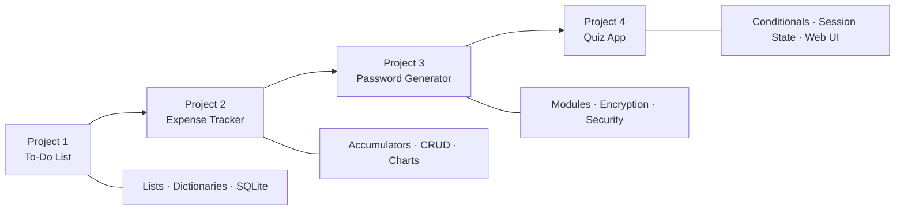

# DecodeLabs Python Programming — Industrial Training Kit

**Batch 2026** · Powered by [DecodeLabs](https://www.decodelabs.tech)

This repository contains four progressive Python projects from the **DecodeLabs Industrial Training Kit**. Each milestone starts from a core programming concept taught in the training slides and grows into a polished, portfolio-ready application built with modern UI patterns, local persistence, and real-world workflows.

Together, these projects demonstrate a full learning arc: **data management ? numerical processing ? security & modules ? interactive logic & user experience**.

---

## Table of Contents

- [Overview](#overview)
- [Repository Structure](#repository-structure)
- [Learning Path](#learning-path)
- [Projects](#projects)
  - [Task 1 — Apex TaskMaster Pro (To-Do List)](#task-1--apex-taskmaster-pro-to-do-list)
  - [Task 2 — ApexExpense (Expense Tracker)](#task-2--apexexpense-expense-tracker)
  - [Task 3 — VaultShield Pro (Password Generator)](#task-3--vaultshield-pro-password-generator)
  - [Task 4 — General Knowledge Quiz](#task-4--general-knowledge-quiz)
- [Getting Started](#getting-started)
- [Dependencies](#dependencies)
- [About DecodeLabs](#about-decodelabs)

---

## Overview

The training kit simulates the journey of a **Junior Python Developer at DecodeLabs**. Each project unlocks the next and focuses on a distinct backend-thinking skill:

| Project | Core Concept | Training Focus |
|---------|--------------|----------------|
| **1 — To-Do List** | Lists & data structures | Store multiple items, add/view tasks, IPO model |
| **2 — Expense Tracker** | Math & accumulators | Process numerical data, running totals |
| **3 — Password Generator** | Modules & strings | `random`, `string`, secure generation |
| **4 — General Knowledge Quiz** | Conditionals & logic | Question flow, scoring, user interaction |

The implementations in this repo go beyond the baseline CLI exercises described in the course materials. They extend each concept into a complete desktop or web application with SQLite databases, custom UI components, analytics, and export capabilities.

---

## Repository Structure

```
PromptEngineering/
??? Python Project 1.pdf      # Course slides — To-Do List
??? Python Project 2.pdf      # Course slides — Expense Tracker
??? Python Project 3.pdf      # Course slides — Password Generator
??? Python Project 4.pdf      # Course slides — Quiz App
??? Task 1/                   # Apex TaskMaster Pro
??? Task 2/                   # ApexExpense
??? Task 3/                   # VaultShield Pro
??? Task 4/                   # General Knowledge Quiz (Streamlit)
??? README.md
```

Each `Task` folder is a **standalone application** with its own entry point and local database file (created automatically on first run).

---

## Learning Path



Projects are designed to be completed **in order**. Project 1 is the mandatory starting point; each subsequent project builds on patterns introduced earlier (persistent storage, structured data, user input handling).

---

## Projects

### Task 1 — Apex TaskMaster Pro (To-Do List)

> **Training goal:** Build a program where users can add tasks to a list and view them.  
> **Key skill:** Lists (`append` & print loops), dictionaries as table rows, persistence with files/databases.

**Application:** `Apex TaskMaster Pro` — a full-featured task manager with a modern Tkinter interface and SQLite backend.

**Highlights:**
- Task CRUD with priorities, categories, tags, due dates, and subtasks
- Smart filters: Active, Today, Upcoming, Overdue, Completed, Archived
- Real-time search, priority filter, and multi-column sorting
- **Dashboard** with completion metrics and activity charts
- **Pomodoro timer** linked to tasks for focus sessions
- Dark/light theme toggle
- Export to **JSON** or **CSV**
- Keyboard shortcuts (`Ctrl+N`, `Ctrl+F`, `Ctrl+T`)

**Run:**
```bash
cd "Task 1"
python main.py
```

**Main modules:** `main.py`, `database.py`, `dashboard_view.py`, `pomodoro_view.py`, `task_dialog.py`, `data_manager.py`, `custom_widgets.py`, `theme.py`

---

### Task 2 — ApexExpense (Expense Tracker)

> **Training goal:** Create a script where users enter expense amounts and the program adds them up to display **Total Spent**.  
> **Key skill:** Math operations & accumulators (`total = total + new_expense`).

**Application:** `ApexExpense` — a desktop financial tracker built with CustomTkinter and Matplotlib.

**Highlights:**
- Expense & income transaction management with categories and payment methods
- **Dashboard** with KPI cards: net balance, monthly spent, total spent
- Canvas donut chart (category breakdown) and bar chart (14-day trend)
- **Budgets & savings goals** with progress bars
- **Analytics** tab with embedded Matplotlib charts
- Multi-currency support (USD, EUR, GBP, etc.)
- Search and category filtering on transactions
- CSV export and demo data reset
- Dark/light appearance mode

**Run:**
```bash
cd "Task 2"
python main.py
```

**Main modules:** `main.py`, `database.py`, `dialogs.py`, `custom_widgets.py`, `theme.py`

---

### Task 3 — VaultShield Pro (Password Generator)

> **Training goal:** Write a tool that asks for a password length and generates a random, complex password using letters and numbers.  
> **Key skill:** Importing modules (`import random`) & string manipulation.

**Application:** `VaultShield Pro` — a password generator and encrypted local vault.

**Highlights:**
- **Custom password generator** with length slider (4–64), character toggles, and ambiguous-character exclusion
- Live **strength meter** with entropy estimate and crack-time analysis
- **Passphrase modes:** Diceware, pronounceable, and PIN generation
- **Encrypted vault** (master password + salted hash + AES-style encryption)
- Save, search, copy, and delete vault entries
- **Security audit** tab with breach-check simulator and vault health report
- Bulk password generator with export
- Dark/light theme

**Run:**
```bash
cd "Task 3"
python main.py
```

**Main modules:** `main.py`, `crypto_utils.py`, `database.py`, `dialogs.py`, `custom_widgets.py`, `theme.py`

---

### Task 4 — General Knowledge Quiz

> **Training goal:** Build an interactive quiz application using conditional logic, structured question data, and score tracking.  
> **Key skill:** `if`/`else` branching, dictionaries/lists for Q&A, user input validation, and program flow control.

**Application:** A **Streamlit** web quiz with 30+ questions across 7 categories.

**Categories:** Geography · Science & Nature · History & Culture · Pop Culture & Entertainment · Sports & Games · Food & Cuisine

**Highlights:**
- Configurable quiz length (3, 5, 10, or 15 questions) and category filter
- **50:50 lifeline** and **hint lifeline** per question
- Instant feedback with explanations after each answer
- Progress bar, live score, and session history in the sidebar
- Detailed answer review screen with score badges
- Glassmorphism UI, animated gradients, and audio feedback cues
- Play-again flow with randomized question selection

**Run:**
```bash
cd "Task 4"
streamlit run app.py
```

**Main modules:** `app.py`, `questions.py`, `ui_components.py`

---

## Getting Started

### Prerequisites

- **Python 3.9+** recommended
- A terminal / command prompt
- For Task 4: a modern web browser (Streamlit opens automatically)

### Installation

1. Clone or download this repository.
2. Create and activate a virtual environment (recommended):

```bash
python -m venv venv

# Windows
venv\Scripts\activate

# macOS / Linux
source venv/bin/activate
```

3. Install dependencies:

```bash
pip install customtkinter matplotlib streamlit
```

> Tasks 1 and 3 use **Tkinter**, which ships with most Python installations. Tasks 2 and 4 require the packages above.

4. Navigate to any task folder and run the application (see [Projects](#projects) for exact commands).

### First Run Notes

| Task | Database / Data File | Auto-created |
|------|----------------------|--------------|
| Task 1 | `taskmaster_pro.db` | Yes — includes sample tasks if empty |
| Task 2 | `expenses.db` | Yes — seeded with demo transactions |
| Task 3 | `vault_data.db` | Yes — set a master password on first vault use |
| Task 4 | In-memory (`st.session_state`) | No file persistence needed |

---

## Dependencies

| Package | Used In | Purpose |
|---------|---------|---------|
| `tkinter` | Task 1, Task 3 | Desktop GUI (stdlib) |
| `customtkinter` | Task 2 | Modern themed widgets |
| `matplotlib` | Task 2 | Financial charts & analytics |
| `streamlit` | Task 4 | Web-based quiz interface |
| `sqlite3` | Task 1, 2, 3 | Local persistence (stdlib) |

Optional: create a `requirements.txt` at the repo root:

```txt
customtkinter>=5.2.0
matplotlib>=3.7.0
streamlit>=1.28.0
```

---

## About DecodeLabs

These projects are part of the **DecodeLabs Industrial Training Kit (Batch 2026)**, designed to help interns build a real-world portfolio through hands-on Python practice.

> *"The absolute best way to master Python development is through hands-on practice, not just theory. As you build these milestones at DecodeLabs, you are creating a real-world portfolio that showcases your backend thinking to future employers."*

**Contact DecodeLabs**

- Website: [www.decodelabs.tech](https://www.decodelabs.tech)
- Email: decodelabs.tech@gmail.com
- Phone: +91 89330 06408
- Location: Greater Lucknow, India

---

## License & Usage

This repository was developed as part of a DecodeLabs internship / training program. Use it as a learning reference and portfolio showcase. Adapt and extend individual tasks as you continue your Python journey.
